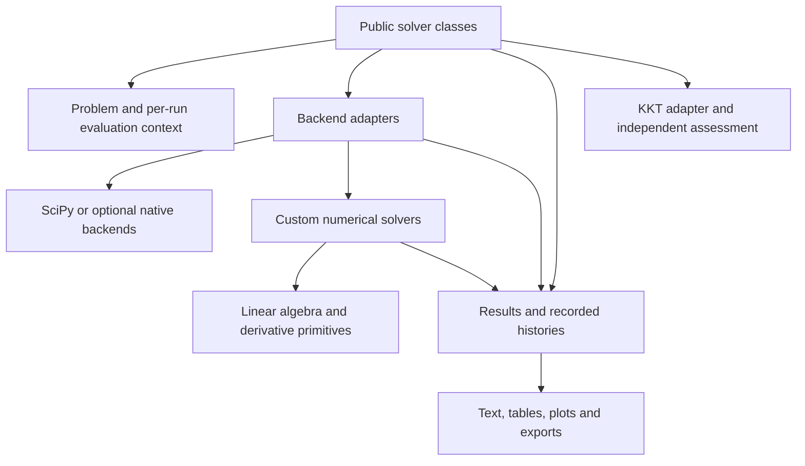

# Proposed source layout and package organization

**Status: structural refactor implemented 25 October 2026.** The proposal below
records the original baseline and rationale; its old source paths refer to that
baseline. The implementation now lives in [src/pysolver_view/](src/pysolver_view/).
See the [migration guide](docs/source/source_layout.rst) for canonical imports,
compatibility and the selected behavior changes, and [PROGRESS.md](PROGRESS.md)
for fresh validation. Release versioning, downstream application migration and
the remaining behavioral follow-ups are separate work.

**Workflow scope correction:** the user subsequently requested preserving the
existing GitHub workflow behavior. The CI modernization suggestions below are
not applied. The two existing test jobs invoke `tests/run_tests.py`, which owns
test selection and options. The user selected the full suite and approved its
required SciPy dependency update.

## Recommendation

Keep the existing name **pysolver_view** for the repository, Python import, and
distribution. Adopt a `src/` layout with the implementation in
`src/pysolver_view/`. The target repository shape is
`pysolver_view/src/pysolver_view/`, and users continue to write
`import pysolver_view as psv`. No additional import namespace or distribution
rename is proposed.

**Organize the implementation by problem type.** Root-specific problems,
frontends, backend adapters and numerical solvers belong under `roots/`;
their optimization counterparts belong under `optimization/`. Each domain
contains its own `solver.py`, `problems/`, `backends/` and `solvers/`.
Shared diagnostics, differentiation, reporting, history and exceptions remain
at package level. Package-wide implementation directories named `solvers/`
and `backends/` are replaced by these domain-specific locations.

The most valuable internal change is to separate the large solver frontends
into orchestration, model evaluation, backend adapters, and presentation.
The custom root numerical modules and shared KKT mathematics already have
useful boundaries. Preserve those boundaries rather than reorganizing every
file merely for symmetry.

Start with a mechanical move to `src/pysolver_view/`, prove that installation
works, then extract responsibilities in small changes while preserving existing
public imports. This separates packaging changes, internal module changes, and
numerical behavior changes into independently reviewable steps.

## Scope and current baseline

The review covers all **26 Python files, approximately 8,240 physical lines**,
under the current `pysolver_view/` source directory, including the recently
integrated custom root solvers in the working tree. Counts include comments and
blank lines; they identify concentration, not a measure of code quality.
Packaging, tests, documentation, demos, development runners, and representative
neighboring consumers were also inspected.

This is an architectural/static review. It does not establish new numerical
test results or execute optional optimization backends. The preceding integration
record in [PROGRESS.md](PROGRESS.md) reports 418 passing tests, with ten Hessian
tests excluded. That is existing evidence, not a fresh validation of this proposal.

The older [feature review](development/pysolverview_feature_review.md) and
[solver migration proposal](development/proposed_refactor.md) contain historical
findings. Some have since been fixed: authoritative final results, point-consistent
histories, shared KKT mathematics, custom SLSQP, and public custom root integration
already exist. This proposal starts from that implemented state.

## 1. Adopt a source layout while retaining the current name

| Concern | Current | Proposed | Compatibility consequence |
| --- | --- | --- | --- |
| Repository/directory name | `pysolver_view/` | Unchanged | Existing checkout paths and local path dependencies remain valid. |
| Source layout | Package beside `pyproject.toml` | Package beneath `src/` | Development needs an installed/editable package; packaging and script paths must be updated. |
| Python import | `import pysolver_view` | Unchanged | Preserve public symbols and supported submodule paths during internal reorganization. |
| Distribution requirement | `pysolver_view` / `pysolver-view` | Unchanged | Existing dependency names continue to identify the same distribution. |

A `src/` layout helps prevent tests and commands from accidentally importing the
checkout instead of the installed package. It is a good fit for this library,
especially because installed-wheel verification remains open. Flat layouts are
valid too; moving files alone does not improve numerical architecture or prove
that a wheel works. [PyPA: src layout versus flat layout](https://packaging.python.org/en/latest/discussions/src-layout-vs-flat-layout/).

`pysolver_view` and `pysolver-view` normalize to the same distribution name.
Keep `name = "pysolver_view"` in the package metadata and
`import pysolver_view` in Python. This refactor needs no new PyPI name,
distribution transfer, or second compatibility package.
[PyPA: name normalization](https://packaging.python.org/en/latest/specifications/name-normalization/).

The implementation will live at
`C:/Users/roagr/git_projects/pysolver_view/src/pysolver_view/`.
Compatibility re-exports may still be needed **within the same package** when
existing public modules are split or relocated.

## 2. Source inventory and recommended destinations

Paths in the first column are relative to the current `pysolver_view/` package.
Destinations are relative to the proposed `src/pysolver_view/` package. Several
rows intentionally map to multiple destinations because responsibilities need
to be extracted, not merely renamed.

| Current source | Lines | Assessment and proposed home |
| --- | ---: | --- |
| [`__init__.py`](pysolver_view/__init__.py) | 48 | Replace wildcard exports with an intentional public API. Move optional JAX loading out; remove host configuration only as a documented behavior change. |
| [`optimization.py`](pysolver_view/optimization.py) | 2,316 | Split into `optimization/solver.py`, `evaluation.py`, `scaling.py`, `constraints.py`, `kkt_adapter.py`, lightweight `optimization/problems/base.py`, and reporting modules. |
| [`nonlinear_system.py`](pysolver_view/nonlinear_system.py) | 739 | Split into `roots/solver.py`, native-root evaluation support, the SciPy root adapter, `roots/problems/base.py`, and reporting modules. |
| [`custom_optimization.py`](pysolver_view/custom_optimization.py) | 59 | Keep its narrow adapter role; move to `optimization/backends/custom.py`. |
| [`custom_root.py`](pysolver_view/custom_root.py) | 133 | Move to `roots/backends/custom.py`; gradually replace access to the entire frontend with an explicit run context. |
| [`optimization_wrappers.py`](pysolver_view/optimization_wrappers.py) | 713 | Separate SciPy optimization, PyGMO, nonfree-plugin loading, and NLOpt-through-PyGMO adapters. Put capability/dispatch metadata in a small registry. |
| [`optimization_problems.py`](pysolver_view/optimization_problems.py) | 336 | Split the bundled problems into `optimization/problems/rosenbrock.py`, `constrained_rosenbrock.py`, `hs71.py`, and `lorenz.py`. Keep existing public class exports. |
| [`nonlinear_system_problems.py`](pysolver_view/nonlinear_system_problems.py) | 59 | Move the bundled Lorenz root problem to `roots/problems/lorenz.py`; preserve its existing `LorentzEquations` spelling as an alias if corrected. |
| [`numerical_differentiation.py`](pysolver_view/numerical_differentiation.py) | 284 | Separate first derivatives, existing Hessian utilities, optional JAX loading, and the private SciPy differentiation dependency. Preserve public helpers. |
| [`pysolver_utilities.py`](pysolver_view/pysolver_utilities.py) | 436 | Split plotting style/export, logging setup, text formatting/introspection, and dictionary validation into modules named for those responsibilities. |
| [`diagnostics/kkt.py`](pysolver_view/diagnostics/kkt.py) | 438 | Keep as the independent mathematical KKT implementation. Separate callers' data gathering and report formatting from this mathematics. |
| [`solvers/slsqp.py`](pysolver_view/solvers/slsqp.py) | 760 | Group under `optimization/solvers/slsqp/`: numerical driver, options/evaluation types, and public exports. Do not rewrite the state machine during relocation. |
| [`solvers/_slsqp_backend.py`](pysolver_view/solvers/_slsqp_backend.py) | 141 | Move beside the driver as `optimization/solvers/slsqp/_scipy_backend.py`; retain local version checks and the SciPy license. |
| [`solvers/exceptions.py`](pysolver_view/solvers/exceptions.py) | 23 | Move the shared public `DomainError` to package-level `exceptions.py`; preserve one class identity and old imports. |
| [`solvers/root/solver.py`](pysolver_view/solvers/root/solver.py) | 83 | Move the numerical modules to `roots/solvers/` and keep the four-function dispatcher. Move aliases/display metadata into lightweight `roots/methods.py`. |
| [`solvers/root/options.py`](pysolver_view/solvers/root/options.py) | 251 | Keep the related option dataclasses together. Extract small repeated validation helpers if useful, without an inheritance hierarchy. |
| [`solvers/root/trust_region.py`](pysolver_view/solvers/root/trust_region.py) | 364 | Keep Levenberg-Marquardt and Powell hybrid functions with their shared trust-region engine. |
| [`solvers/root/line_search.py`](pysolver_view/solvers/root/line_search.py) | 349 | Keep Newton-Raphson and Gauss-Newton functions with their shared full-step/backtracking engine. |
| [`solvers/root/linear_model.py`](pysolver_view/solvers/root/linear_model.py) | 346 | Keep QR/SVD state, rank/condition decisions, factor updates, and step construction together. |
| [`solvers/root/evaluation.py`](pysolver_view/solvers/root/evaluation.py) | 182 | Keep ownership of custom residual/Jacobian calls, domain validation, and budgets. Share derivative primitives only where policies remain explicit. |
| [`solvers/root/history.py`](pysolver_view/solvers/root/history.py) | 63 | Keep numerical trial/accepted records separate from public plotting histories. Later pass counters explicitly instead of reading the evaluator through a back-reference. |
| [`solvers/root/trial_step.py`](pysolver_view/solvers/root/trial_step.py) | 67 | Keep actual trial-coordinate construction and rounding-aware distance checks together. |
| [`solvers/root/exceptions.py`](pysolver_view/solvers/root/exceptions.py) | 11 | Keep internal budget/probe termination signals local; import the shared public domain exception. |
| [`diagnostics/__init__.py`](pysolver_view/diagnostics/__init__.py), [`solvers/__init__.py`](pysolver_view/solvers/__init__.py), [`solvers/root/__init__.py`](pysolver_view/solvers/root/__init__.py) | 5 + 5 + 29 | Retain explicit exports and keep initializers lightweight. Compatibility exports must point to canonical objects. |

The existing `solvers/root/` numerical modules move together to `roots/solvers/`,
with their established responsibilities retained. Public legacy solver paths
can forward to these implementations during migration.

The [SciPy license](pysolver_view/solvers/SCIPY_LICENSE.txt) is also part of the
source inventory and must remain included in source and wheel distributions.

The problem definitions currently under
[`development/root_step_control/src/problems/`](development/root_step_control/src/problems/)
also become installed source under `roots/problems/`. Their migration is detailed
below; they are additional to the 26-file runtime inventory above.

## 3. Confirmed structural problems

### Frontends combine unrelated responsibilities

`OptimizationSolver` currently owns backend selection, caching, derivatives,
scaling, callbacks, histories, live figures, text/file exports, named constraints,
KKT compatibility fields, and final results. Relevant boundaries are visible at
`optimization.py:333` (solve), `:449` (evaluation), `:691` (recording),
`:982` (presentation/export), `:1214` (named diagnostics), and `:1906`
(problem interface). Large commented report implementations also obscure the
active code around lines 1602-1784.

The root frontend has the same smaller-scale mixture. For example,
`nonlinear_system.py:434` names a method `_print_convergence_progress`, but it
records observations, updates state, renders output, plots, and dispatches
callbacks. Recording and presenting should be separate operations.

This extraction should retain public convenience methods such as
`plot_convergence_history()` and report printers. Users should not have to
assemble internal services just to solve a problem and view its history.

### Problem definitions depend on solver and UI modules

`OptimizationProblem` and `NonlinearSystemProblem` are defined in their large
frontend modules. Bundled and development problems import those interfaces,
bringing in much more infrastructure than a model definition needs.

Move `OptimizationProblem` to `optimization/problems/base.py` and
`NonlinearSystemProblem` to `roots/problems/base.py`. Keep their existing methods and
subclass behavior through re-exports; do not force users to adopt a new protocol
or rename `gradient()` to `jacobian()` during the structural migration.
Existing optimization scaling convenience methods can delegate to extracted
coordinate utilities while maintaining their signatures.
Keep domain package initializers lightweight or use lazy exports, so importing
`optimization.scaling` from a problem compatibility method does not initialize
`OptimizationSolver` and recreate an import cycle. Problem contracts must not
import frontend or presentation code.

### Problem subpackages within optimization and roots

Use **`optimization/problems/` and `roots/problems/` subpackages**, with one
descriptively named module per concrete problem. Group problems by their public
interface: optimization problems provide objectives, constraints and bounds;
root problems provide residual equations. This keeps each collection alongside
the frontend that uses its contract, without creating a shared problem catalogue
at the package root.

This makes equations, derivatives, bounds, and problem-specific metadata
easy to find without searching a collection of unrelated classes. Keep those
methods together in the problem's module rather than separating all residuals,
Jacobians, and bounds into different files.

Each subpackage's `base.py` contains its corresponding lightweight interface.
Its `__init__.py` provides explicit convenient exports; importing a base interface
should not eagerly import every concrete problem or optional dependency.
Retain top-level exports and compatibility modules for existing imports such as
`pysolver_view.optimization_problems.RosenbrockProblem`.

For example, the proposed public imports can be:

```python
from pysolver_view.optimization.problems import OptimizationProblem
from pysolver_view.roots.problems import NonlinearSystemProblem
from pysolver_view.optimization.problems.rosenbrock import RosenbrockProblem
from pysolver_view.optimization.problems.hs71 import HS71Problem
```

Keep the Lorenz root problem in `roots/problems/lorenz.py` and its optimization
formulation in `optimization/problems/lorenz.py`. The optimization formulation
can reuse the root problem's equations through composition instead of duplicating
them; it must not depend on the root solver frontend. Existing class names and
constructor behavior remain supported; correcting the Lorenz spelling is a
separate alias/documentation decision.

### Promote the reusable development problems into source

Move the reusable contents of `development/root_step_control/src/problems/`
to **`src/pysolver_view/roots/problems/`**, applying the same one-problem-per-module
organization. These classes are useful for demos, regression tests, external
experiments and user examples independently of the study scripts. Keep one
implementation of each problem and have development runners import it.

| Current development module | Proposed source destination |
| --- | --- |
| `base.py` | Extend `roots/problems/base.py` with `BenchmarkProblem`, dimension validation and reusable reference metadata, alongside `NonlinearSystemProblem`. The benchmark subclass remains optional for user-defined models. |
| `mathematical.py` | Split into named modules for extended Rosenbrock, Powell singular, Powell badly scaled, Brown almost linear, Broyden tridiagonal, discrete boundary value, discrete integral equation, helical valley, coupled overdetermined Rosenbrock and logarithmic-domain problems. |
| `thermodynamics.py` | `roots/problems/heated_gas_duct.py`, retaining residuals, analytic derivatives, physical residuals and solution diagnostics. |
| `suites.py` | `roots/problems/suites.py` for reusable problem collections. Benchmark execution, timing options and report generation remain in development runners. |
| `__init__.py` | Explicit exports from `roots/problems/__init__.py`, with lazy optional-dependency loading. |

Preserve constructors, dimensions, initial guesses, variable scales, known roots,
root-existence flags and source references. Retain `residual()`, `gradient()` and
problem-specific diagnostic methods. These are part of reproducibility, not
benchmark-runner orchestration.

CoolProp remains an **optional dependency**: ordinary package imports, mathematical
problems and solver use must work without it. Load it when constructing a
thermodynamic problem, with an actionable installation error if unavailable.
Provide an optional thermodynamics dependency extra when packaging the model.
The numerical solvers must not import concrete problem classes merely because
they now share the same domain package.

Retain development-side forwarding imports temporarily if needed for existing
scripts, then remove them after migration checks. They must import the packaged
classes rather than retain copies of their implementation. Benchmark runners,
sensitivity settings, timing instrumentation, plotting and `results_*` artifacts
remain under development. This supersedes the earlier proposal to keep the
problem definitions there as well.

### Backend boundaries and names are inconsistent

Native optimization dispatch lives in `optimization_wrappers.py`, native root
execution lives inside `NonlinearSystemSolver`, and custom adapters are top-level
files. Group adapters under `optimization/backends/` and `roots/backends/`,
beside their corresponding public frontends and custom numerical solvers.

`_PygmoProblem` is constructed for **every** optimization backend
(`optimization.py:370`, definition at `:2284`). It combines generic evaluation
callbacks with PyGMO-specific derivative flattening. Replace that conceptual
role with a generic optimization evaluation context, then keep flattening in
the PyGMO adapter. Its lambda-based ownership deliberately avoids deep-copying
non-copyable property objects; preserve that property when extracting it.

The native root frontend imports method metadata from the custom numerical
dispatcher (`nonlinear_system.py:16`). Recognizing `hybr` should require only
lightweight metadata, not importing all custom iteration engines.

### The package initializer configures the host process

Importing the package can replace `sys.excepthook`, force the JAX CPU platform,
enable JAX 64-bit mode, and change the JAX logger level. Numerical differentiation
and examples then import JAX globals back from the package initializer, making
import order part of their implementation.

Use explicit optional-dependency loading in `differentiation/_jax.py` and keep
host configuration opt-in. Preserve and document any supported availability
query during the transition. Removing automatic configuration is a behavior
change, so give it its own migration note and checks.

Wildcard exports also expose imported implementation names. An explicit export
list must be based on actual use, not just aesthetic cleanup. For example,
`psv.approx_derivative` is used by current tests, even though it reaches the
top level through a private SciPy import in another module. Treat it as a used
compatibility surface until an explicit alternative/deprecation is supplied.

### Optional dependencies and private APIs need clear ownership

- `optimization_wrappers.py:11-18` imports PyGMO and its nonfree plugin in the
  same `try` block. Missing the plugin marks ordinary PyGMO unavailable. Load
  dependencies independently in the adapters that need them.
- The custom SLSQP bridge already isolates its private SciPy dependency and
  version guard. Preserve that boundary; do not impose its SciPy pin on roots
  or all package imports.
- `numerical_differentiation.py:2` and `nonlinear_system_problems.py:2` import
  private `scipy.optimize._numdiff.approx_derivative`. The former is also used
  for bound-aware differentiation in the custom optimization frontend. Isolate
  this dependency before considering a replacement; replacing it can change
  numerical behavior and boundary handling.
- Plotting, pandas report tables, optional JAX, CoolProp benchmark models, and
  native plugin loading should not be eager requirements of custom root math.
  Lazy imports are useful even if a dependency remains declared as mandatory;
  changing dependency extras is a separate compatibility decision.

### Run state belongs to a solve, not the reusable model

The optimization constructor writes `problem_scale` and generated variable
names onto the problem (`optimization.py:206-215`). Two solver objects sharing
one model can interfere through that mutable configuration. Introduce explicit
per-run evaluation/scaling state as a later extraction, retaining legacy access
where necessary. Do not deep-copy a stateful thermodynamic model by default.

The custom root adapter currently modifies many frontend-private fields. A
small context carrying counters, accepted snapshots, recording, and callbacks
would make this boundary clearer. It need not be a general event framework.

### KKT mathematics is already consolidated

There is no reason to create another mathematical KKT checker. The existing
`diagnostics/kkt.py` performs assessment/reconstruction. Frontend methods gather
model data and translate legacy fields; custom-driver adapters convert signs
and coordinates. Extract those adapter/reporting responsibilities into
`optimization/kkt_adapter.py` and `reporting/tables.py` while keeping one
mathematical implementation.

## 4. Proposed package tree

The agreed structure places custom SLSQP under
`optimization/solvers/slsqp/` and the four custom root methods under
`roots/solvers/`. Their adapters live alongside them in
`optimization/backends/` and `roots/backends/`.

This is the intended end-state map. Create a module when its extraction is made;
do not add empty placeholders or split every small helper into its own file.
Package `__init__.py` files are omitted below except where they clarify the API.
Small forwarding modules for supported existing imports also remain inside
`pysolver_view` where needed; they do not form a second package.

```text
pysolver_view/                     # Existing repository name
|-- pyproject.toml
|-- README.md
|-- PROGRESS.md
|-- refactor.md
|-- src/
|   `-- pysolver_view/             # Single implementation package
|       |-- __init__.py            # Explicit convenient public exports
|       |-- exceptions.py          # One shared public DomainError
|       |-- results.py             # Internal result normalization/contracts
|       |-- history.py             # Public event records and run counters
|       |-- validation.py          # Dictionary/schema validation helpers
|       |-- optimization/
|       |   |-- solver.py          # Public OptimizationSolver orchestration
|       |   |-- evaluation.py      # Objective/constraint cache and derivatives
|       |   |-- scaling.py         # Coordinate maps and derivative transforms
|       |   |-- constraints.py     # Packing, counts and named constraint layout
|       |   |-- kkt_adapter.py     # Same-point data, units, legacy report mapping
|       |   |-- problems/
|       |   |   |-- __init__.py
|       |   |   |-- base.py        # OptimizationProblem
|       |   |   |-- rosenbrock.py
|       |   |   |-- constrained_rosenbrock.py
|       |   |   |-- hs71.py
|       |   |   `-- lorenz.py      # Optimization formulation
|       |   |-- backends/
|       |   |   |-- registry.py
|       |   |   |-- scipy.py
|       |   |   |-- custom.py
|       |   |   |-- pygmo.py
|       |   |   |-- pygmo_nonfree.py
|       |   |   `-- pygmo_nlopt.py
|       |   `-- solvers/
|       |       `-- slsqp/
|       |           |-- driver.py
|       |           |-- options.py
|       |           |-- _scipy_backend.py
|       |           `-- SCIPY_LICENSE.txt
|       |-- roots/
|       |   |-- solver.py          # Public NonlinearSystemSolver orchestration
|       |   |-- evaluation.py      # Native-root cache and derivative accounting
|       |   |-- methods.py         # Lightweight names and aliases for both backends
|       |   |-- problems/
|       |   |   |-- __init__.py
|       |   |   |-- base.py        # NonlinearSystemProblem, BenchmarkProblem
|       |   |   |-- suites.py      # Reusable problem collections, not study runners
|       |   |   |-- lorenz.py
|       |   |   |-- extended_rosenbrock.py
|       |   |   |-- powell_singular.py
|       |   |   |-- powell_badly_scaled.py
|       |   |   |-- brown_almost_linear.py
|       |   |   |-- broyden_tridiagonal.py
|       |   |   |-- discrete_boundary_value.py
|       |   |   |-- discrete_integral_equation.py
|       |   |   |-- helical_valley.py
|       |   |   |-- coupled_overdetermined_rosenbrock.py
|       |   |   |-- logarithmic_domain.py
|       |   |   `-- heated_gas_duct.py  # Optional CoolProp model and diagnostics
|       |   |-- backends/
|       |   |   |-- registry.py
|       |   |   |-- scipy.py
|       |   |   `-- custom.py
|       |   `-- solvers/
|       |       |-- solver.py      # solve_root dispatch to four numerical methods
|       |       |-- options.py
|       |       |-- trust_region.py
|       |       |-- line_search.py
|       |       |-- linear_model.py
|       |       |-- trial_step.py
|       |       |-- evaluation.py
|       |       |-- history.py
|       |       `-- exceptions.py  # Internal termination signals
|       |-- diagnostics/
|       |   `-- kkt.py             # Independent mathematical assessment
|       |-- differentiation/
|       |   |-- finite_difference.py
|       |   |-- hessians.py        # Existing optional helpers, no redesign
|       |   |-- _jax.py            # Lazy optional dependency access
|       |   `-- _scipy_numdiff.py  # Isolated private compatibility dependency
|       `-- reporting/
|           |-- text.py
|           |-- tables.py
|           |-- plots.py
|           |-- style.py
|           `-- logging.py
|-- tests/                        # Installed-package unit/integration tests
|-- demos/                        # Short executable examples using public API
|-- development/                  # Study orchestration, results and design notes
|   `-- root_step_control/
|       |-- tests/                # Runner/instrumentation checks
|       |-- run_*.py               # Import problem definitions from the package
|       `-- results_*/
`-- docs/
```

The three solver-related responsibilities are distinct within each domain:

| Location | Responsibility |
| --- | --- |
| `optimization/solver.py` and `roots/solver.py` | Coordinate the public `OptimizationSolver` and `NonlinearSystemSolver` interfaces, run setup and final results. |
| `optimization/backends/` and `roots/backends/` | Translate calls, options, callbacks and results between the public interface and the selected implementation. |
| `optimization/solvers/` and `roots/solvers/` | Contain custom numerical algorithms and their method-specific state and controls. |

Numerical solvers must remain independent of frontend and plotting code.
Moving them beneath a domain does not authorize imports back into its public
frontend. Domain initializers must preserve this separation. Shared functionality
stays at package level; only supported legacy import paths may remain as
forwarding modules in the former locations.

The broader distinction is:

- `roots/` and `optimization/` provide the common user experience across libraries
  and contain their own problem interfaces and bundled problem definitions.
- Each domain's `backends/` translates that experience to a selected implementation.
- Each domain's `solvers/` implements its custom numerical algorithms.
- `diagnostics/` assesses supplied mathematical data independently.
- `reporting/` consumes recorded data and never evaluates the physical model.

There is no benefit in adding a broad `core/`, `base/`, or `utils/` package to
hold whatever does not fit. Name shared modules after the work they perform.

## 5. Dependency direction and internal contracts



This is ownership/data flow, not a requirement that every solver use one
evaluation engine. In particular:

1. **One derivative owner per execution path.** Custom root differentiation
   remains owned by its numerical evaluator, so probes consume its budgets.
   Native-root and optimization contexts have their own adapter requirements.
   Share formulas and validation where safe, not incompatible accounting rules.
2. **Preserve method-specific controls.** Root limits constrain scaled distance
   $\|p/s\|_2$; custom SLSQP limits fractions of native directions and preserves
   native merit-search state. Do not force them through one generic step controller.
3. **Keep events honest.** Accepted moves, native major-iteration observations,
   function/Jacobian observations, derivative probes, and rejected trials remain
   distinguishable. A common history must not invent unavailable acceptance or
   iteration counts.
4. **Use small internal records first.** Extract counters, point snapshots and
   result assembly without replacing public `OptimizeResult` objects/history
   dictionaries with a new mandatory user-facing type. Preserve detached arrays.
5. **Keep reporting passive.** Text/table/plot functions consume snapshots;
   callbacks and optional KKT requests remain explicit orchestration decisions.
   Plotting must not trigger residual, derivative, or KKT evaluations.
6. **Use a simple capability registry.** Record supported problem shapes,
   constraints, derivative inputs, exposed events, cancellation and step controls
   by backend/method. Unknown/unverified support should remain explicit. No
   dynamic plugin framework or automatic solver selector is needed.

The root numerical `history.py` and package-level `history.py` have different
jobs: the first retains algorithm trial details and low-level callbacks; the
second supports common public observations. Define their boundary before
sharing helpers. Repeated result/history copies are a measured optimization
opportunity, not permission to introduce mutable aliases.

## 6. Numerical organization to retain

Keep four named root functions dispatched by `solve_root()` and two internal
engines. Trust-region and line-search algorithms have different acceptance and
recovery rules. Merging their loops would obscure those rules; copying each
engine into two complete solvers would duplicate bookkeeping.

`linear_model.py` is a suitable name because it owns factors and Broyden updates
as well as solving linear subproblems. `trial_step.py` is more precise than
`step_scaling.py`: it constructs trial coordinates and checks actual represented
displacements. Keep both names unless their responsibilities actually change.

Keep custom root modules under `roots/solvers/`, with lightweight method metadata
in `roots/methods.py`. Native and custom adapters can share that metadata without
loading the numerical engines. Domain initializers must remain lightweight so
importing numerical code does not initialize a frontend or presentation layer.

For SLSQP, separating options from the numerical driver and grouping the private
bridge beside it is enough initially. Its long solve closure could eventually
become an explicit per-run object, but that changes state ownership and deserves
its own tests. Preserve the current bridge behavior and local compatibility guard.

Keep KKT assessment independent of the solver backend. Public inequalities use
the existing nonpositive convention; the custom SLSQP driver uses nonnegative
inequalities. Sign, scale, and multiplier conversions belong at explicit adapter
boundaries. Root residual acceptance must remain separate from KKT acceptance.

## 7. Compatibility and the public API

Keep the current convenience imports and preserve supported submodule imports
when implementations move:

```python
import pysolver_view as psv
from pysolver_view.nonlinear_system import NonlinearSystemProblem
from pysolver_view.optimization import OptimizationProblem

assert NonlinearSystemProblem is psv.NonlinearSystemProblem
assert OptimizationProblem is psv.OptimizationProblem
```

Compatibility exports must reference the **same objects**, not copied class
definitions. Use explicit forwarding modules or package exports where public
modules move, with a documented export list. For example,
`pysolver_view.nonlinear_system` can re-export the extracted root frontend and
problem interface. Preserve supported existing submodule paths, not only
`import pysolver_view` at the top level. There is only one import namespace.

Inventory and retain the solver/problem classes, options, domain exception,
numerical entry points, KKT helpers, packing helpers, used differentiation
utilities, example classes, plotting/logging helpers, and version constants.
Correct accidental API leakage gradually; do not silently remove a name that
tests or consumers actually use.

Structural work should preserve:

- Constructor positional arguments, native SciPy defaults, and `solve()` returning
  physical solution vectors.
- Authoritative `result`/`backend_result`, existing history keys and report methods.
- Canonical author names and their short aliases, with backend identity explicit.
- Callback contracts: native observations are different from custom accepted-point
  notifications; cancellation semantics must not change accidentally.
- Custom-root trial budgets versus accepted `nit`, and probe counts as a subset
  of physical model calls.
- Shared exception identity, option dataclass identity, problem subclass checks,
  inequality signs, multiplier units, and unavailable KKT states.
- Low-level custom solvers remaining usable without the common frontend.

Tests that monkeypatch `pysolver_view.optimization_wrappers.minimize` or other
implementation globals need deliberate migration. Re-exporting a function does
not redirect the globals used inside its canonical defining module. Preserve
documented runtime behavior; update internal patch locations and test import
compatibility separately. Private monkeypatch paths are not automatically a
permanent public API promise.

Current nearby consumers reinforce the need to preserve public imports:

| Consumer evidence | Implication |
| --- | --- |
| [Turbodash dependency](../turbodash/pyproject.toml) declares optional `pysolver-view = "^0.6.9"`; tests patch existing module names. | Keep the dependency name and public import paths. Its current runtime source has no direct `pysolver_view` import; do not assume its custom driver already uses this package. |
| [Jaxprop dependency](../jaxprop/pyproject.toml) declares `pysolver_view = "^0.6.8"`. Its [root calculations](../jaxprop/jaxprop/coolprop/core_calculations.py) and [fluid properties](../jaxprop/jaxprop/coolprop/fluid_properties.py) use the solver classes directly. | Existing imports continue unchanged; include representative consumer imports/subclassing in migration checks to protect against internal module moves. |

Retaining distribution names does not override version constraints: those
`^0.6.x` requirements exclude `0.7.0`. A later version bump may still require
consumer dependency/lock updates. No dependency-name or import-name edits are
required solely by the `src/` move. Internal public API changes, if any, must be
assessed separately from source layout.

## 8. Packaging, scripts, documentation and CI

For the single-package `src/` layout, an explicit package selection using
the current Poetry metadata style would be:

```toml
[tool.poetry]
name = "pysolver_view"  # Existing distribution identity
packages = [
    { include = "pysolver_view", from = "src" },
]
include = [
    { path = "src/pysolver_view/optimization/solvers/slsqp/SCIPY_LICENSE.txt", format = ["sdist", "wheel"] },
]
```

This snippet augments the existing metadata; it is not a complete replacement
`pyproject.toml`. For the first mechanical move, keep the license at
`src/pysolver_view/solvers/SCIPY_LICENSE.txt`; update that path when the SLSQP
sources are grouped. Explicit Poetry package selection disables automatic
package detection; the single entry above selects the retained package.
Inspect the built archives to verify the license's installed location.
[Poetry: packages and file inclusion](https://python-poetry.org/docs/pyproject/#packages).

Keep Poetry for this refactor. Switching build backends, changing all metadata
to another style, or adding an unrelated environment tool would expand the scope.

Necessary repository updates include:

- **Development installation:** document `poetry install` or the appropriate
  editable installation. Demos should import the installed package. Do not add
  `repo/src` to every script as a substitute for installation.
- **Development-only imports:** benchmark runners may still need a repository
  path for `development.*` helper modules. Keep this explicitly separate from
  production package discovery; `development` must not become a runtime dependency.
- **Documentation:** [build_docs.py](docs/build_docs.py) derives its source path
  from the distribution name. Give it an explicit source path resolved from
  `__file__`. [conf.py](docs/conf.py) inserts the repository root on `sys.path` when run from `docs/`;
  prefer installed-package imports and regenerate API pages for the reorganized modules.
- **Versions:** update [.bumpversion.toml](.bumpversion.toml), the initializer,
  package metadata and docs paths. Single-source version metadata later if useful;
  preserve the public `pysolver_view.__version__` value.
- **Tests:** [run_tests.py](tests/run_tests.py) lists only three older test files.
  Use documented pytest discovery commands instead of treating it as complete
  coverage. Audit subprocess tests that manually prepend the repository root.
- **CI environments:** [the publish workflow](.github/workflows/publish_to_pipy.yml)
  uses Poetry 1.8.2 on Windows, an unpinned installer on Linux, and a lockfile
  generated by Poetry 2.1.2. Align the tooling; this is a static inconsistency,
  not an observed CI failure in this review.
- **Dependency matrix:** distinguish general package/root compatibility from
  custom SLSQP's SciPy 1.17.1 requirement. The declared Python range alone does
  not demonstrate that every custom backend is supported on every combination.
- **Publication:** the workflow also runs on pull requests, while the publish
  job has no tag-only condition. Make publication explicitly release/tag-only
  during CI cleanup. No publishing is part of this proposal.

## 9. Tests, examples and development studies

Suggested test grouping:

```text
tests/
|-- public_api/        # Public exports, supported module paths and constructors
|-- optimization/      # Frontend results, scaling, histories and callbacks
|   |-- problems/      # Optimization problems and interface checks
|   |-- backends/      # In-scope adapter contracts
|   `-- solvers/       # SLSQP numerical driver and private bridge
|-- roots/             # Frontend results, derivative accounting and callbacks
|   |-- problems/      # Packaged mathematical and optional thermodynamic models
|   |-- backends/      # Native/custom root adapter contracts
|   `-- solvers/       # Numerical methods, factors, limits and recovery
|-- diagnostics/       # KKT mathematics and adapter/reporting contracts
|-- differentiation/   # Required first derivatives; optional existing helpers
|-- reporting/         # Plot/report purity and detached observations
`-- packaging/         # Installed imports, license contents and export identity
```

Move pure numerical root tests to `tests/roots/solvers/` and problem-definition,
derivative and physical-model checks to `tests/roots/problems/`. Split mixed test
files by those responsibilities. The latter can now import the installed problem
classes directly; they must not depend on development modules. Keep thermodynamic
checks optional when CoolProp is absent and run them in an environment with the
optional dependency when validating the packaged thermodynamic problems.
Benchmark-runner, suite-use and timing-instrumentation checks remain under
`development/root_step_control/tests/`.

Keep root benchmark execution, sensitivity studies and `results_*` directories
under development. `run_*.py` files retain their study-specific execution and
plotting code, importing reusable problem definitions from the installed package.
Do not turn runners into thin wrappers.

Keep the single public four-solver demo independent of development imports.
The existing public problems and the promoted root problem collection are
installed under `optimization/problems/` or `roots/problems/`, one concrete
problem per module. Existing public exports remain supported. Shipping these
reusable classes does not require shipping research scripts/results or making
CoolProp a mandatory runtime dependency.

## 10. Follow-up behavior changes: separate from relocation

These issues are supported by the inspected source but should have focused
changes after the import/layout boundaries are stable:

| Issue | Evidence and recommended treatment |
| --- | --- |
| Shared mutable problem scaling | `optimization.py:206-215` changes caller-owned state. Move run configuration out of the model with explicit compatibility handling; separately address fixed/unbounded scaling. |
| Coupled optional backend availability | `optimization_wrappers.py:11-18` couples PyGMO to its nonfree plugin. Independent availability checks can be validated without executing those backends. |
| NLOpt option-name mismatch | The frontend supplies `tolerance`/`max_iterations`; `minimize_nlopt` consumes `tol`/`max_iter` at `optimization_wrappers.py:600-601`. Normalize the adapter contract. This was found statically, not by a new NLOpt run. |
| Hidden numerical work in bundled root example | `LorentzEquations.gradient()` internally performs complex-step residual evaluations. The solver sees a Jacobian call, not those probes. Supply the small analytic Jacobian or delegate numerical derivatives to the solver. |
| Derivative shape/step conventions differ | Legacy helpers use squeezed output shapes and nominal differences; the custom root evaluator checks represented probe distances and budgets. Harmonize primitives only with explicit shape, rounding, bounds and accounting tests. |
| Import-time host configuration | Remove automatic exception-hook/JAX/logger changes in a documented change; offer explicit configuration where needed. |
| Root logger ownership | `create_logger()` calls `logging.basicConfig()` and returns the root logger. Consider a named logger with explicit handlers and predictable repeated calls; preserve or deprecate old behavior deliberately. |
| Repeated result/history copies | Preserve detached data first. Use the existing interface timing study to justify later reductions or lazy text formatting. |
| Naming/documentation drift | The Lorenz example is named `LorentzEquations`; the nonlinear problem doc example references nonexistent `RootFindingProblem`. Correct docs and retain aliases for used class names. |

Do not combine this work with new algorithms, replacement KKT mathematics,
new root defaults, changed acceptance tolerances, or a universal scaling/step
controller. There is no new requirement to execute PyGMO, IPOPT, SNOPT, or
validate Hessian helpers; the previously agreed migration scope still applies.

## 11. Implementation order and completion criteria

| Stage | Focused change | Completion evidence |
| --- | --- | --- |
| 0 | Record the current working-tree baseline and public import/behavior inventory. Keep existing unfinished work separate. | Supported exports, deep imports, callbacks, counters and compatibility expectations are explicit. |
| 1 | Mechanical `src/pysolver_view/` move; package selection, license paths, docs/test entry points. No internal redesign or numerical changes. | Editable install works; wheel and sdist build; imports and smoke solves work outside the checkout. |
| 2 | Establish supported public exports and forwarding modules within `pysolver_view` before splitting implementation modules. Keep repository, import and distribution names unchanged. | Top-level and supported submodule imports resolve to identical classes, exceptions, options and functions; representative consumers still import. |
| 3 | Extract lightweight problem contracts into `optimization/problems/base.py` and `roots/problems/base.py`, shared exceptions and method metadata; make exports explicit. | Subclassing and existing imports work; importing the problem interfaces does not load every concrete problem, UI or development code. |
| 4 | Group adapters and numerical implementations under each domain's `backends/` and `solvers/`, starting with native/custom roots and SciPy/custom optimization. Isolate remaining PyGMO mappings by inspection. | Same authoritative results, option semantics, failure/callback behavior and physical call accounting; low-level solver imports do not initialize the frontend or UI. |
| 5 | Extract optimization evaluation/scaling/constraint context and KKT data adapter. Keep numerical checker unchanged. | Same-point caches, derivative ownership, signs, units and non-copyable model ownership pass regressions. |
| 6 | Extract public histories and passive reports/plots; preserve convenient frontend methods. | Passive renderers add no model work or mutation; explicitly requested diagnostics retain counted evaluation costs. Event meanings and result ownership remain correct. |
| 7 | Group SLSQP sources, separate derivative dependencies, split bundled problems by domain and move `development/root_step_control/src/problems/` into `roots/problems/`, one module per concrete problem. Move numerical/problem tests into package tests and update development imports. | Problem methods, metadata, exports, suite selections and numerical contracts remain valid; mathematical imports work without CoolProp and optional thermodynamic tests pass when installed. Study runners, instrumentation tests, design notes and generated results remain in development. License inclusion and the standalone demo are preserved. |
| 8 | Address selected behavior issues in separate changes; finish docs/CI and consumer release preparation. | Each behavior change has its own tests/migration note; release version is chosen from the actual compatibility scope. |

File-move and internal-module rename commits should be easy to inspect before
extracting or changing behavior. Reuse current tests as regression guards; update implementation-specific
patch targets intentionally. Do not require every numerical trajectory to match
historical runs, but a pure relocation should normally retain deterministic
behavior. Investigate lost convergence, added model calls, broken controls, and
material timing regressions rather than dismissing them as refactor effects.

The installation gate must use a **built wheel in a clean environment**, from
outside the checkout, without `PYTHONPATH` or source-path injection. Check both
top-level and supported submodule imports, class/exception identity, representative
native/custom solves, and license contents. Build the sdist too and verify it can produce the expected
wheel. Include import/solve checks using the promoted mathematical problems,
confirm imports work without CoolProp, and validate the optional thermodynamic
problem separately. A copied source directory or successful editable install
is insufficient.

Run package tests separately from development benchmarks. Validate SciPy SLSQP,
custom SLSQP, all four custom roots, native LM/hybrid, shared KKT, histories,
callbacks and first-derivative accounting within the agreed scope. Rerun the
multidimensional convergence suite after the extraction sequence and repeat
timings when execution paths or recording costs change. Full turbine application
migration remains a separately authorized task.

**Suggested first deliverable:** complete Stage 1 only, with package imports and
wheel/sdist validation. It provides the requested source-layout foundation and
resolves the existing installation-validation gap before the larger internal
reorganization begins.
